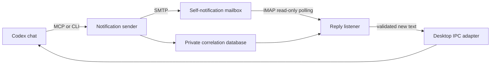

# Architecture

`config.py` owns connection validation and credential storage. `mail.py` sends
MIME emails over TLS. `bridge.py` owns notification correlation, parsing, UID
watermarks and reply deduplication. `desktop_ipc.py` is the experimental desktop
transport seam. The CLI, MCP and service installer expose those functions.

Notifications have a cryptographically random correlation value and an actual
chat UUID. Some providers replace the sender-generated Message-ID. An independent
random header on the delivered original lets the listener learn its replacement.
This requires the original to be delivered into the monitored mailbox.

The listener first reads new-message headers using BODY.PEEK. It reads a full
body only when references match a recent notification, the sender is the original
recipient, the email is within the size limit, and it is not an automated reply.
Email references spanning different target chats are rejected.

Replies are recorded as delivering before desktop submission. A repeated
Message-ID or mailbox UID is not sent twice. An uncertain result is retained
for review rather than re-executed. This is not an exactly-once delivery claim:
crashes between submission and recording the outcome still require inspection.

IMAP network failures reconnect on a later polling pass. A changed UIDVALIDITY
stops useful processing until manually reviewed instead of guessing which
historical emails to replay. The initial watermark starts at the current end.

The MCP service does not perform continuous inbox polling. The optional login
service is a separate process, so replies can arrive while a chat is waiting.
Automatic completion hooks and independent crash monitoring are outside this version.
